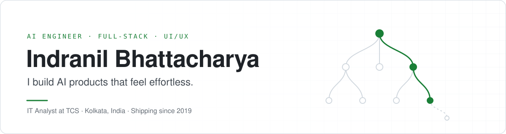
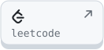
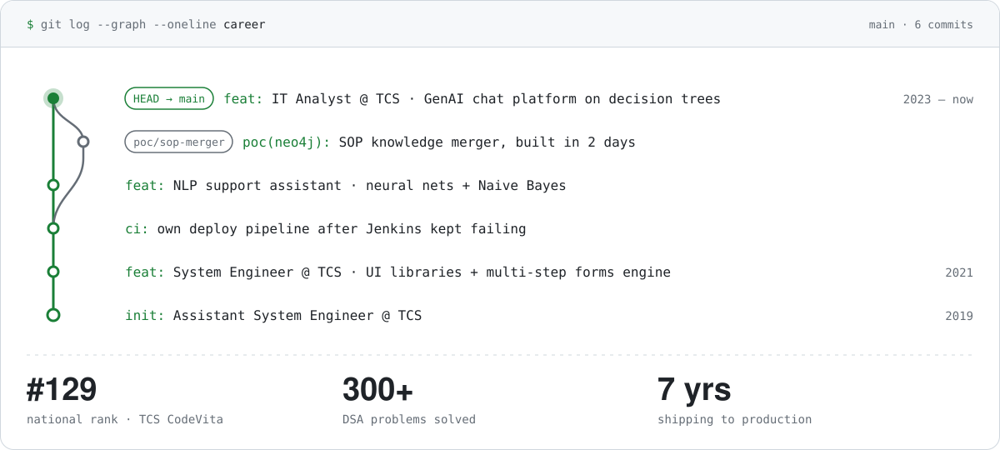
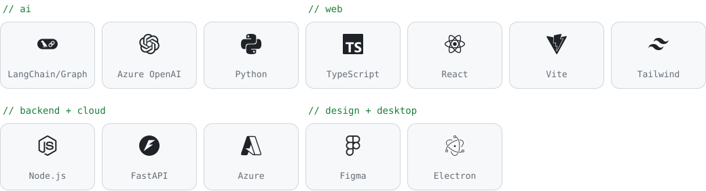

<picture>
  <source media="(prefers-color-scheme: dark)" srcset="assets/banner-dark.svg">
  
</picture>

  <a href="https://indranildev.in"><picture><source media="(prefers-color-scheme: dark)" srcset="assets/key-portfolio-dark.svg"></picture></a>
  <a href="https://www.linkedin.com/in/indranil-bhattacharya/"><picture><source media="(prefers-color-scheme: dark)" srcset="assets/key-linkedin-dark.svg"></picture></a>
  <a href="mailto:indranil.b.professional@gmail.com"><picture><source media="(prefers-color-scheme: dark)" srcset="assets/key-email-dark.svg"></picture></a>
  <a href="https://leetcode.com/u/Indranil-Bhattacharya"><picture><source media="(prefers-color-scheme: dark)" srcset="assets/key-leetcode-dark.svg"></picture></a>
  <a href="https://x.com/IndranilBuilds"><picture><source media="(prefers-color-scheme: dark)" srcset="assets/key-x-dark.svg"></picture></a>

<picture>
  <source media="(prefers-color-scheme: dark)" srcset="assets/career-dark.svg">
  
</picture>

### `ls ~/side-projects`

| project | what it does |
|---|---|
| **Music Producer Portfolio** · [live ↗](https://subhasishmusic.com/) | Next.js site pulling live YouTube + Spotify data |
| **KEY BLOCKER** · [Chrome Web Store ↗](https://chromewebstore.google.com/detail/mpicjlfceecpdhjignmoaipcgpdaoogl) | Privacy-first site blocker with cross-device sync |
| **Web Annotator Tool** · [code ↗](https://github.com/IndranilBhattacharya/Web-Annotator-Tool) | Custom web annotation tool · React, Vite, shadcn/ui |

### `cat stack.txt`

<picture>
  <source media="(prefers-color-scheme: dark)" srcset="assets/stack-dark.svg">
  
</picture>
